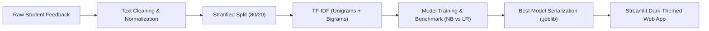

# CampusPulse AI — Smart Student Feedback Analyzer 🎓

[](https://www.python.org/)
[](LICENSE)
[](https://streamlit.io/)
[](https://scikit-learn.org/)

**CampusPulse AI** is an NLP-powered student evaluation and feedback intelligence dashboard built for colleges and universities. It automatically analyzes open-ended student comments to determine **Sentiment Polarity** (Positive, Neutral, Negative) and classify the **Campus Department/Topic** (Teaching, Labwork, Examination, Library Facilities, Course Content, Extracurricular).

---

## 🚀 Key Features

- **Dual-Task NLP Classification**:
  - **Task 1: Sentiment Analysis** (Positive, Neutral, Negative).
  - **Task 2: Topic / Category Classification** (Teaching, Examination, Labwork, Library Facilities, Course Content, Extracurricular).
- **Leakage-Free NLP Machine Learning Pipeline**:
  - TF-IDF vectorizer with unigram and bigram representation (`ngram_range=(1, 2)`), sublinear frequency scaling, and vocabulary filtering fitted strictly on training data.
  - Rigorous benchmark between **Multinomial Naive Bayes** and **Logistic Regression** (with cost-sensitive `class_weight='balanced'`).
  - True held-out test evaluation measuring Accuracy, Precision, Recall, and Macro-F1.
- **Premium Academic Web Dashboard (Streamlit)**:
  - 📊 **Executive Dashboard**: Real-time KPI summary cards, sentiment donut chart, category distribution, and critical grievance breakdown.
  - 🔍 **Live Feedback Analyzer**: Interactive text area with pre-loaded student samples, instant prediction badges, and class probability distributions.
  - 📂 **Feedback Explorer**: Searchable, filterable data grid with instant CSV export.
  - 📈 **Model Evaluation**: Transparent side-by-side metric tables, classification reports, and confusion matrix figures.
  - 📖 **About Project**: Complete academic methodology documentation, workflow diagrams, and citations.

---

## 📁 Repository Structure

```text
CampusPulseAI/
├── app.py                     # Streamlit multi-page web dashboard
├── train_model.py             # NLP pipeline training & evaluation script
├── inspect_dataset.py         # Dataset inspection and statistical profiling
├── requirements.txt           # Python dependency specifications
├── README.md                  # Project setup and usage guide
├── .gitignore                 # Standard Python & environment ignore rules
├── .streamlit/
│   └── config.toml            # Dark-theme and headless server configuration
├── data/
│   ├── student_feedback.csv   # Hugging Face student feedback dataset (724 rows)
│   └── student_feedback_cleaned.csv # Cleaned & normalized dataset
├── models/
│   ├── metadata.json          # Class labels, best model names, and metadata
│   ├── sentiment_best_model.joblib   # Best sentiment classifier pipeline
│   ├── sentiment_nb_pipeline.joblib  # Naive Bayes sentiment pipeline
│   ├── sentiment_lr_pipeline.joblib  # Logistic Regression sentiment pipeline
│   ├── category_best_model.joblib    # Best category classifier pipeline
│   ├── category_nb_pipeline.joblib   # Naive Bayes category pipeline
│   └── category_lr_pipeline.joblib   # Logistic Regression category pipeline
└── reports/
    ├── evaluation_results.json# Full JSON metrics, reports, and confusion matrices
    ├── project_report.md      # Comprehensive 15-section academic report
    ├── viva_questions.md      # 15 beginner-friendly viva voce questions and answers
    └── figures/
        ├── sentiment_confusion_matrix.png
        ├── sentiment_model_comparison.png
        ├── category_confusion_matrix.png
        └── category_model_comparison.png
```

---

## 🛠️ Step-by-Step Installation & Quickstart (Windows PowerShell)

Follow these exact commands in Windows PowerShell to set up and run the project locally.

### 1. Open PowerShell and Navigate to the Project Folder
```powershell
cd "C:\Users\thebe\Desktop\CampusPulseAI"
```

### 2. Create and Activate Virtual Environment
```powershell
# Using the installed Python 3.13
& "C:\Users\thebe\AppData\Local\Programs\Python\Python313\python.exe" -m venv .venv

# Or if 'python' is in your system PATH:
python -m venv .venv
```

### 3. Install Required Dependencies
```powershell
.\.venv\Scripts\python.exe -m pip install --upgrade pip
.\.venv\Scripts\python.exe -m pip install -r requirements.txt
```

### 4. Inspect the Dataset
Run the inspection script to verify column types, check for missing values, and review class distributions:
```powershell
.\.venv\Scripts\python.exe inspect_dataset.py
```

### 5. Train and Evaluate NLP Models
Train both Naive Bayes and Logistic Regression models on held-out test splits, save serialized pipelines to `models/`, and generate confusion matrices in `reports/figures/`:
```powershell
.\.venv\Scripts\python.exe train_model.py
```

### 6. Launch the Streamlit Web Application
```powershell
.\.venv\Scripts\python.exe -m streamlit run app.py
```
After running this command, open your browser and navigate to:
```
http://localhost:8501
```

---

## 📊 Verified Machine Learning Benchmark Results

Evaluated strictly on held-out 20% test data ($N = 145$, `random_state=42`):

### Task 1: Sentiment Classification
| Metric | Multinomial Naive Bayes | Logistic Regression (Balanced) | Delta (LR vs. NB) |
| :--- | :---: | :---: | :---: |
| **Accuracy** | 69.66% | **77.93%** | **+8.27%** |
| **Macro Precision** | 59.76% | **68.74%** | **+8.98%** |
| **Macro Recall** | 49.11% | **67.94%** | **+18.83%** |
| **Macro F1-Score (Primary)** | 50.19% | **68.31%** | **+18.12%** |
| **Weighted F1-Score** | 64.65% | **77.72%** | **+13.07%** |

*Selected Model:* **Logistic Regression** (significantly higher Macro-F1 due to inverse-class-frequency weighting).

### Task 2: Category Classification (6 Departmental Areas)
| Metric | Multinomial Naive Bayes | Logistic Regression (Balanced) | Delta (LR vs. NB) |
| :--- | :---: | :---: | :---: |
| **Accuracy** | 63.45% | **64.83%** | **+1.38%** |
| **Macro Precision** | 64.58% | **66.74%** | **+2.16%** |
| **Macro Recall** | 63.34% | **64.81%** | **+1.47%** |
| **Macro F1-Score (Primary)** | 62.71% | **64.60%** | **+1.89%** |
| **Weighted F1-Score** | 62.76% | **64.68%** | **+1.92%** |

*Selected Model:* **Logistic Regression**.

---

## 🏗️ System Architecture Workflow



---

## 📚 Dataset Source & Attribution
- **Dataset:** Student Feedback Sentiment
- **Hugging Face Repository:** [Hannes111/student_feedback_sentiment](https://huggingface.co/datasets/Hannes111/student_feedback_sentiment)
- **Original Source:** Kaggle Student Feedback Dataset (`brarajit18/student-feedback-dataset`)
- **Total Records:** 724 labeled comments across 6 departmental categories.

---

## 🎓 Academic Viva & Exam Preparation
See [reports/viva_questions.md](reports/viva_questions.md) for 15 essential viva voce questions and model answers, and [reports/project_report.md](reports/project_report.md) for the complete 15-section project report.
