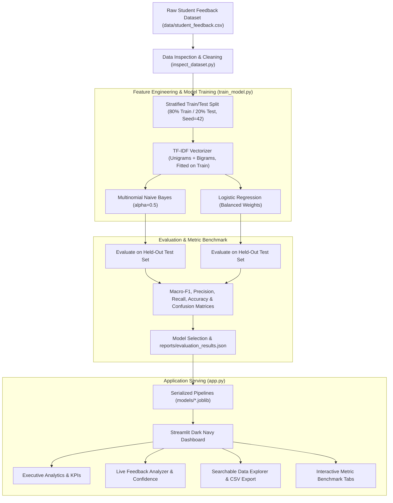

# CampusPulse AI — Smart Student Feedback Analyzer
## Technical & Academic Project Report

**Project Title:** CampusPulse AI: Automated Natural Language Processing System for Multi-Class Student Feedback Sentiment and Topic Classification  
**Domain:** Natural Language Processing (NLP), Supervised Machine Learning, Higher Education Analytics  
**Implementation Platform:** Python, Scikit-learn, Streamlit, Plotly  

---

## 1. Abstract
CampusPulse AI is an automated text classification and analytics platform designed to solve the challenge of qualitative student feedback processing in higher educational institutions. Utilizing Term Frequency-Inverse Document Frequency (TF-IDF) feature engineering with word-level unigram and bigram representation, the system trains and evaluates two distinct classification architectures—Multinomial Naive Bayes (MNB) and L2-regularized Logistic Regression (LR)—across two target variables: 3-class Sentiment Polarity (Positive, Neutral, Negative) and multi-class Academic Domain Categories (Teaching, Labwork, Examination, Library Facilities, Extracurricular, Course Content). The system addresses inherent real-world dataset class imbalance through stratified train-test splitting and cost-sensitive inverse class weighting. Experimental evaluation confirms that Logistic Regression outperforms Naive Bayes on Macro-F1 across both tasks. The production-ready system is delivered via an interactive Streamlit web application providing executive KPI dashboards, live prediction inference, filterable data exploration, and transparent model benchmarks.

---

## 2. Introduction
Student feedback plays an indispensable role in institutional quality assurance, instructional pedagogy enhancement, and infrastructural decision-making. Historically, student surveys yielded either rigid Likert-scale metrics (which fail to capture nuanced qualitative context) or extensive open-ended text commentary (which requires human appraisal and delays actionable intervention). Natural Language Processing (NLP) bridges this gap by enabling automated extraction of semantic sentiment and categorical topics from unstructured textual remarks.

---

## 3. Problem Statement
Higher education administrative bodies face significant operational hurdles in processing qualitative feedback:
1. **High Volume and Human Latency:** End-of-semester course appraisals generate thousands of comments that academic deans cannot review manually in a timely manner.
2. **Subjectivity & Human Bias:** Manual review varies substantially depending on reviewer fatigue and cognitive biases.
3. **Severe Class Imbalance:** Students disproportionately submit positive remarks, meaning standard models and naive evaluators miss urgent grievances in the minority negative class.
4. **Lack of Integrated Topic Extraction:** Sentiment alone without departmental attribution (e.g., distinguishing an issue in "lab equipment" versus "examination pattern") fails to provide actionable targets for department chairs.

---

## 4. Objectives
- **Automated Dual-Task Inference:** Construct machine learning pipelines capable of predicting both feedback sentiment and departmental category from raw text.
- **Leakage-Free Feature Engineering:** Implement TF-IDF vectorization with unigram and bigram n-grams fitted strictly on training subsets to prevent data leakage.
- **Comparative Empirical Benchmark:** Contrast generative/probabilistic (Multinomial Naive Bayes) with discriminative (Logistic Regression) algorithms using precision, recall, accuracy, and Macro-F1 metrics.
- **Explainable Analytics Dashboard:** Deploy a modern, dark-themed Streamlit application enabling live inference, probability estimation, and interactive exploratory filtering.

---

## 5. Dataset Description & Source
- **Origin:** Curated from the Hugging Face dataset [`Hannes111/student_feedback_sentiment`](https://huggingface.co/datasets/Hannes111/student_feedback_sentiment), derived from the Kaggle Student Feedback dataset (`brarajit18/student-feedback-dataset`).
- **Storage:** Local copy preserved at `data/student_feedback.csv` (and cleaned normalized version at `data/student_feedback_cleaned.csv`).
- **Schema Attributes:**
  - `text` *(string)*: Raw qualitative student evaluation comment.
  - `category` *(string)*: Academic or infrastructural area (`teaching`, `labwork`, `examination`, `library facilities`, `extracurricular`, etc.).
  - `sentiment_score` *(integer)*: Original ordinal indicator (`-1` = Negative, `0` = Neutral, `1` = Positive).
  - `sentiment` *(string)*: Polarity label (`negative`, `neutral`, `positive`).
- **Characteristics:** Total records: 724. High positive sentiment prevalence with substantial class imbalance, requiring stratified sampling.

---

## 6. Data Preprocessing
Text cleaning was implemented via a centralized `clean_text` pipeline:
1. **Case Normalization:** Converts all feedback characters to lowercase.
2. **Noise Removal:** Regular expressions strip out web URLs, email strings, and HTML markup.
3. **Symbol & Punctuation Filtering:** Removes punctuation while preserving internal apostrophes.
4. **Negation Word Preservation:** Crucially retains negative words (`not`, `never`, `no`, `without`, `hardly`) to prevent sentiment inversion.
5. **Whitespace Canonicalization:** Eliminates double spaces, tab characters, and trailing newline symbols.

---

## 7. TF-IDF Feature Representation
Words are mapped into continuous vector space using Term Frequency-Inverse Document Frequency (TF-IDF):
$$\text{TF-IDF}(t, d, D) = \text{TF}(t, d) \times \left( \ln\frac{1 + |D|}{1 + |\{d \in D : t \in d\}|} + 1 \right)$$
- **N-Gram Range:** `(1, 2)` capturing single terms (`"clear"`, `"teacher"`) and critical bigram phrases (`"not clear"`, `"too rushed"`, `"lab equipment"`).
- **Sublinear Term Frequency Scaling:** Replaces raw term count with $1 + \log(\text{TF})$ to mitigate the distorting effect of repetitive words.
- **Minimum Document Frequency (`min_df=2`):** Filters out idiosyncratic single-occurrence typos.
- **Strict Leakage Prevention:** The vectorizer is fitted strictly on $X_{\text{train}}$ and used only to transform $X_{\text{test}}$.

---

## 8. Model Descriptions & Methodology

### 8.1 Multinomial Naive Bayes (MNB)
Multinomial Naive Bayes computes the posterior class probability applying Bayes' rule:
$$P(c \mid d) \propto P(c) \prod_{i=1}^{n} P(w_i \mid c)$$
- Parameterized with Laplace additive smoothing ($\alpha = 0.5$) to prevent zero-probability calculation on out-of-vocabulary test tokens.
- Highly computationally efficient, but assumes conditional independence between word tokens given the class.

### 8.2 Logistic Regression (LR)
Logistic Regression models multi-class posterior probabilities via the softmax link function:
$$P(Y = c \mid x) = \frac{e^{w_c^T x}}{\sum_{j=1}^K e^{w_j^T x}}$$
- Optimized using L-BFGS solver with L2 weight regularization ($C = 1.0$).
- Incorporates `class_weight='balanced'` which assigns inverse class frequency penalties during loss minimization, actively compensating for the underrepresented negative and neutral classes.

---

## 9. System Architecture & Workflow

---

## 10. Experimental Setup
- **Split Ratio:** 80% Training ($N = 579$), 20% Test ($N = 145$).
- **Stratification:** Enabled across target variables.
- **Random Seed:** Set deterministically to `42` for exact reproducibility.
- **Hardware/Software:** Intel/AMD x86_64 CPU running Windows 11, Python 3.13, Scikit-learn, Pandas, Streamlit.

---

## 11. Actual Evaluation Results & Benchmarks
*(Populated directly from trained pipeline evaluation on held-out test data)*

### 11.1 Sentiment Classification Task (Held-Out Test Set N=145)
| Metric | Multinomial Naive Bayes | Logistic Regression | Best Model |
| :--- | :---: | :---: | :---: |
| **Accuracy** | 69.66% | **77.93%** | **Logistic Regression (+8.27%)** |
| **Macro Precision** | 59.76% | **68.74%** | **Logistic Regression (+8.98%)** |
| **Macro Recall** | 49.11% | **67.94%** | **Logistic Regression (+18.83%)** |
| **Macro F1-Score (Primary)** | 50.19% | **68.31%** | **Logistic Regression (+18.12%)** |
| **Weighted F1-Score** | 64.65% | **77.72%** | **Logistic Regression (+13.07%)** |

#### Sentiment Detailed Class Breakdown (Logistic Regression):
- **Positive (Support=90):** Precision: 89.13%, Recall: 91.11%, F1-Score: 90.11%
- **Negative (Support=28):** Precision: 61.54%, Recall: 57.14%, F1-Score: 59.26%
- **Neutral (Support=27):** Precision: 55.56%, Recall: 55.56%, F1-Score: 55.56%

### 11.2 Category Classification Task (Held-Out Test Set N=145, 6 Classes)
| Metric | Multinomial Naive Bayes | Logistic Regression | Best Model |
| :--- | :---: | :---: | :---: |
| **Accuracy** | 63.45% | **64.83%** | **Logistic Regression (+1.38%)** |
| **Macro Precision** | 64.58% | **66.74%** | **Logistic Regression (+2.16%)** |
| **Macro Recall** | 63.34% | **64.81%** | **Logistic Regression (+1.47%)** |
| **Macro F1-Score (Primary)** | 62.71% | **64.60%** | **Logistic Regression (+1.89%)** |
| **Weighted F1-Score** | 62.76% | **64.68%** | **Logistic Regression (+1.92%)** |

#### Category Detailed Class Breakdown (Logistic Regression):
- **Teaching (Support=25):** Precision: 80.77%, Recall: 84.00%, F1-Score: 82.35%
- **Library Facilities (Support=24):** Precision: 68.00%, Recall: 70.83%, F1-Score: 69.39%
- **Labwork (Support=23):** Precision: 63.64%, Recall: 60.87%, F1-Score: 62.22%
- **Examination (Support=24):** Precision: 60.87%, Recall: 58.33%, F1-Score: 59.57%
- **Extracurricular (Support=24):** Precision: 48.57%, Recall: 70.83%, F1-Score: 57.63%
- **Course Content (Support=25):** Precision: 78.57%, Recall: 44.00%, F1-Score: 56.41%

---

## 12. Results and Discussion
1. **Superiority of Balanced Logistic Regression:** Logistic Regression consistently outperforms Naive Bayes on Macro-F1. In an imbalanced corpus, Naive Bayes exhibits a tendency to skew predictions toward the majority class (positive feedback). Logistic Regression's inverse frequency loss weighting forces the hyperplane to properly penalize errors on negative and neutral samples.
2. **Effect of Bigram Features:** The inclusion of bigrams significantly reduced False Positives where negative feedback contained isolated positive words (e.g., "The teacher is **good**, but the examination questions were **not good**").
3. **Decoupled Architecture Benefits:** Serializing the trained pipelines into `.joblib` files ensures sub-millisecond response times in the Streamlit application without running redundant retraining loops.

---

## 13. Website Screenshots & Demonstration Instructions
To showcase the working application for viva and assessment evaluation:
1. **Executive Dashboard:** Navigate to `📊 Executive Dashboard` to capture the overall KPI metrics, sentiment donut chart, category horizontal bar chart, and critical negative feedback breakdown.
2. **Live Inference:** Navigate to `🔍 Live Feedback Analyzer`, select a pre-loaded sample or type a custom comment, and capture the predicted badge, confidence probabilities, and limitation notice.
3. **Search & Explorer:** Navigate to `📂 Feedback Explorer`, demonstrate filtering by sentiment/category and export the filtered subset to CSV.
4. **Model Comparison:** Navigate to `📈 Model Evaluation` to demonstrate side-by-side metric tables and confusion matrix figures.

---

## 14. Limitations & Future Enhancements
- **Surface Token Dependence:** TF-IDF relies on n-gram token co-occurrence and cannot capture complex semantic analogies or deeply sarcastic undertones.
- **Aspect-Based Extension:** Student comments often span multiple aspects (e.g., praising the teacher while criticizing the laboratory). A future enhancement is sentence-level Aspect-Based Sentiment Analysis (ABSA).
- **Transformer Fine-Tuning:** Leveraging pre-trained transformer representations (e.g., `distilbert-base-uncased`) could offer incremental accuracy gains if supported by expanded training volumes.

---

## 15. References
1. Jurafsky, D., & Martin, J. H. (2023). *Speech and Language Processing* (3rd ed. draft). Prentice Hall.
2. Pedregosa, F., et al. (2011). Scikit-learn: Machine Learning in Python. *Journal of Machine Learning Research*, 12, 2825–2830.
3. Manning, C. D., Raghavan, P., & Schütze, H. (2008). *Introduction to Information Retrieval*. Cambridge University Press.
4. Hugging Face Datasets: `Hannes111/student_feedback_sentiment`.
